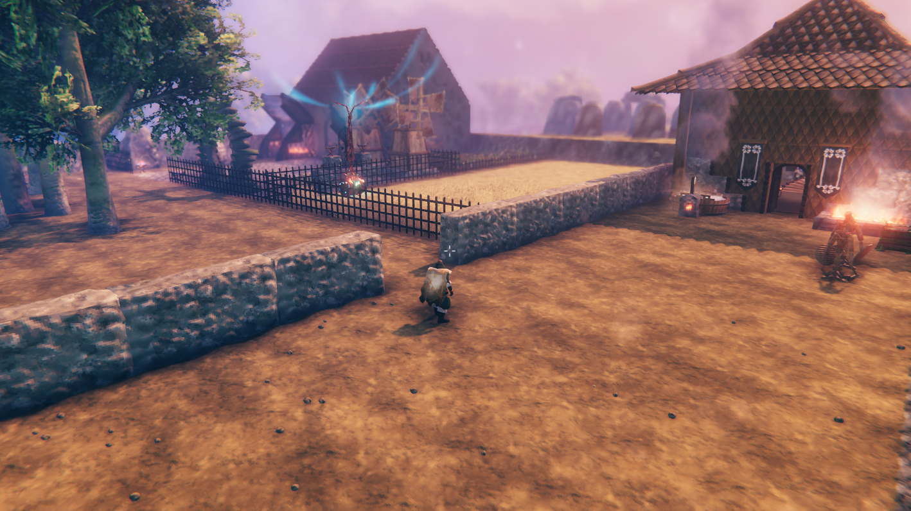
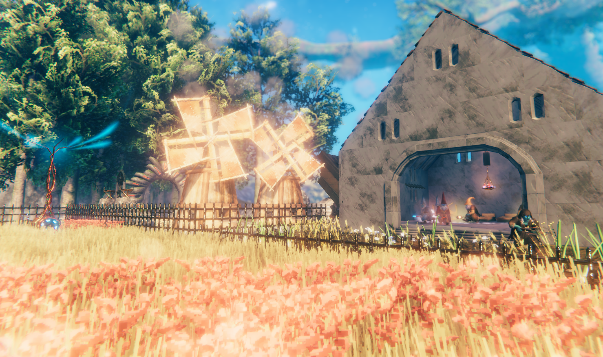
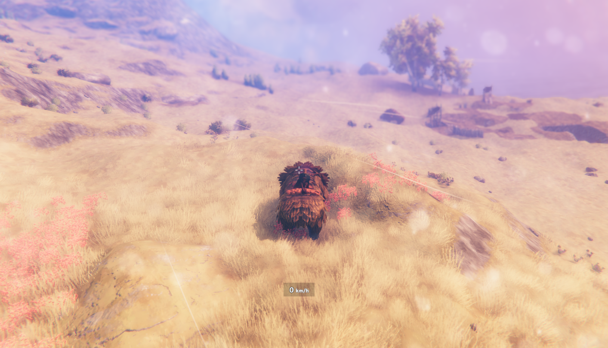

# BetterCamera

Zoom further out or into first person, with zoom limits for walking, sailing and riding, and switch the camera to follow the centre of your ship.

- **Zoom further**: Zoom out up to 16 m while walking, 40 m while steering a ship and 24 m while riding.
- **First person**: Zoom all the way in to look around through your character's eyes.
- **Ship view**: While steering a ship, press `C` to switch the camera to follow the ship's centre, so you can look all around it.

## Camera Views

### Walking (Zoomed Out)

### Walking (First Person)

### Sailing (Zoomed Out)

### Sailing (First Person)

### Riding (Zoomed Out)

## Configuration

Settings are in the BepInEx config file `javidahmed64592.bettercamera.cfg`.

## Compatibility

- Mods that also change the camera's zoom or position (such as first-person mods) may clash with this one.
- This mod has not been tested with a gamepad, only with keyboard and mouse.

## Uninstalling

Nothing is saved to your world or character, so the mod can be removed at any time.

## License

This project is licensed under the MIT License - see the [LICENSE](https://github.com/javidahmed64592/Valheim-BetterCamera/blob/main/LICENSE) file for details.
