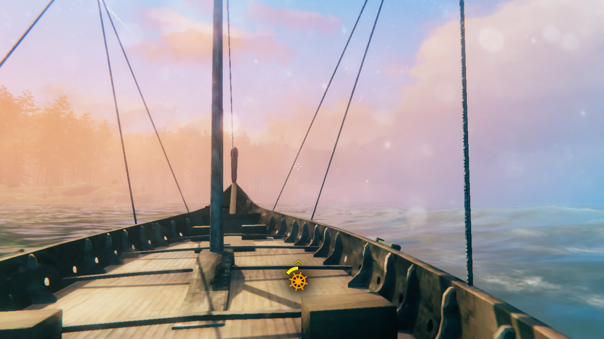
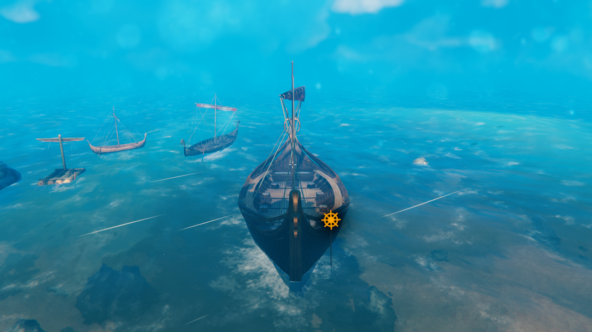

# BetterCamera

Play Valheim in first person, and get more control over the camera while walking, sailing and riding.

- **First person**: Zoom all the way in to play through your character's eyes.
- **Ship view**: While steering a ship, press `Shift+C` to switch the camera to follow the ship's centre.
- **Switch shoulders**: Press `K` to move the third-person camera between your right and left shoulder.
- **Zoom further**: Zoom out up to 16 m while walking, 40 m while steering a ship and 24 m while riding (vanilla 8 m, 16 m on ships). Each has its own limits in the config and remembers its own zoom.

## First Person

Zoom in past the closest third-person distance to switch to first person, and zoom out to leave it.

- Your body stays visible apart from the head, so you see your arms and gear with the game's own animations.
- Bows, spears, staffs and other ranged attacks fly to the crosshair.
- Your body turns with your view once you look more than 60° to the side, and always faces where you look while moving.
- While drawing a bow, the view shifts slightly so the bow doesn't cover the crosshair.
- While sailing, the ship's sail and rudder indicator sits at a fixed spot in front of you.

## Ship View

While steering a ship, press `Shift+C` to switch the camera between following you and following the centre of the ship, so you can look all around it.

## Configuration

Settings are in the BepInEx config file `javidahmed64592.bettercamera.cfg`.

## Compatibility

- Mods that also change the camera's zoom or position (such as first-person mods) may clash with this one.
- This mod has not been tested with a gamepad, only with keyboard and mouse.

## Uninstalling

Nothing is saved to your world or character, so the mod can be removed at any time.

## License

This project is licensed under the MIT License - see the [LICENSE](https://github.com/javidahmed64592/Valheim-BetterCamera/blob/main/LICENSE) file for details.
